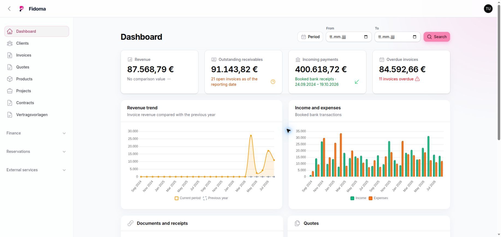
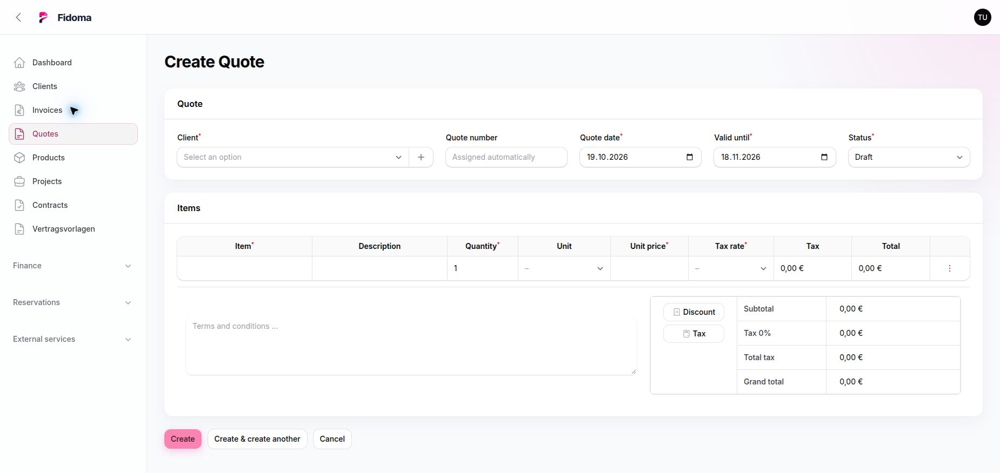

# Fidoma

<div align="center">

### Das modulare, selbst gehostete ERP für moderne Geschäftsprozesse

**Kunden, Projekte, Angebote, Rechnungen, Zahlungen und Dokumente in einer zentralen Anwendung.**

[](https://laravel.com)
[](https://filamentphp.com)
[](https://php.net)
[](https://mysql.com)
[](https://phpunit.de)
[](https://docker.com)

[Funktionen](#funktionen) · [Installation](#installation) · [Entwicklung](#entwicklung) · [Mitwirken](#mitwirken)

</div>

---

## Über Fidoma

Fidoma ist eine Open-Source-ERP-Anwendung für kleine und mittelständische Unternehmen. Die
Anwendung verbindet kaufmännische Abläufe mit einer übersichtlichen, auf Filament basierenden
Administrationsoberfläche. Sie wird vollständig selbst gehostet – Geschäftsdaten bleiben damit
unter eigener Kontrolle.

Der Quellcode ist fachlich nach Features strukturiert. Einzelne Bereiche lassen sich dadurch
klar weiterentwickeln, ohne Geschäftslogik über die gesamte Anwendung zu verteilen.

> **Projektstatus:** Fidoma befindet sich in aktiver Entwicklung. Funktionen und Datenstrukturen
> können sich bis zu einer stabilen Veröffentlichung noch verändern.

## Funktionen

| Bereich | Umfang |
|---|---|
| Dashboard & Berichte | Kennzahlen, Zahlungsübersicht, offene Aufgaben sowie flexible Zeiträume und Quartale |
| Kunden | Zentrale Verwaltung von Kunden- und Kontaktdaten |
| Projekte | Projekte, Bauvorhaben und Aufträge mit eigener Projektnummer und Kundenbezug |
| Angebote | Erstellung, Statusverwaltung und Weiterverarbeitung von Angeboten |
| Rechnungen | Rechnungen, Abschlagsrechnungen, Gutschriften, Stornierungen und Archivierung |
| Zahlungen | Manuelle Zahlungen, Zahlungsarten und Verknüpfung mit Banktransaktionen |
| Banking & Zuordnungen | Importierte Banktransaktionen sowie Rechnungs- und Zahlungszuordnung |
| Verträge | Individuelle Verträge, Vorlagen und projektspezifische Felder |
| Hotel & Reservierungen | Zimmer, Reservierungen und abrechenbare Reservierungspositionen |
| Produkte & Stammdaten | Produkte, Familien, Einheiten, Steuersätze und Nummernkreise |
| Dokumente | Dokumentübersicht und optionale Anbindung an Paperless-ngx |
| Webmail | Integrierter Zugriff auf eine konfigurierte Webmail-Umgebung |
| Internationalisierung | Umschaltbare deutsche und englische Administrationsoberfläche |

Elektronische Rechnungen werden über `horstoeko/invoicesuite` erzeugt. PDF-Ausgaben und
Vorschauen verwenden dieselbe Template-Verarbeitung; eigene Layouts lassen sich mit einem
integrierten HTML-/CSS-Editor bearbeiten.

## Einblicke in Fidoma

Die Administrationsoberfläche ist nach der Installation unter `/admin` erreichbar. Sie bietet
unter anderem konfigurierbare Tabellen, native Filter, Status-Tabs und eine persistente
Spaltenauswahl. Die Oberfläche kann direkt im Benutzer-Menü zwischen Deutsch und Englisch
umgeschaltet werden.

### Dashboard

Das Dashboard bündelt Umsatz, offene Forderungen, Zahlungseingänge und überfällige Rechnungen.
Diagramme stellen die Umsatzentwicklung sowie Einnahmen und Ausgaben im gewählten Zeitraum
gegenüber.



### Rechnungsverwaltung

Status-Tabs, native Filter und konfigurierbare Spalten sorgen auch bei vielen Rechnungen für
einen schnellen Überblick. Abschlags- und Schlussrechnungen werden über die Abrechnungsart
direkt in derselben Verwaltung abgebildet.


### Angebotserstellung

Angebote werden einschließlich Positionen, Steuern und Rabatten in einer kompakten Ansicht
erstellt. Bestehende Produkte, Einheiten und Steuersätze können dabei wiederverwendet werden.



## Technologie

| Technologie | Version | Aufgabe |
|---|---:|---|
| PHP | 8.5 | Laufzeitumgebung |
| Laravel | 13 | Backend und Anwendungsframework |
| Filament | 5 | Administrationsoberfläche |
| Livewire | über Filament | Interaktive Komponenten und Dialoge |
| MySQL | 8.4 | Relationale Datenbank |
| Tailwind CSS | 4 | Styling |
| Vite | 8 | Frontend-Build |
| Laravel Sail | aktuell | Lokale Docker-Entwicklung |
| PHPUnit | 12 | Automatisierte Tests |

## Installation

### Produktionsinstallation mit einem Befehl

Für eine veröffentlichte Fidoma-Version werden nur `curl`, Docker Engine und Docker Compose
v2 benötigt. Der Bootstrap-Installer lädt die drei benötigten Deployment-Dateien in den
Ordner `fidoma` und startet anschließend die Anwendung, MySQL, den Queue-Worker und den
Scheduler:

```bash
curl -fsSL https://fidoma.de/install.sh | bash
```

Wer das Skript vor der Ausführung prüfen möchte, kann es zunächst separat herunterladen:

```bash
curl -fsSLO https://fidoma.de/install.sh
less install.sh
bash install.sh
```

Innerhalb eines bereits entpackten Release-Archivs steht weiterhin der direkte Aufruf zur
Verfügung:

```bash
./setup.sh
```

Das Skript erzeugt beim ersten Lauf `.env.production` mit einem zufälligen Anwendungsschlüssel
und zufälligen Datenbankpasswörtern, lädt das veröffentlichte Fidoma-Image, führt die
Migrationen aus und erstellt ein initiales Administratorkonto. Die einmalig erzeugten
Zugangsdaten werden in `.fidoma-admin` mit ausschließlich lokalen Leserechten gespeichert.
Die Datei sollte nach dem ersten Login gelöscht werden. Der unkritische Statusmarker
`.fidoma-installed` bleibt bestehen, damit spätere Aktualisierungen kein zweites Konto anlegen.

Die Installation ist ohne Rückfragen lauffähig. Bei Bedarf können die wichtigsten Werte für
den ersten Lauf überschrieben werden:

```bash
FIDOMA_PORT=8080 \
FIDOMA_APP_URL=https://erp.example.com \
FIDOMA_ADMIN_EMAIL=admin@example.com \
FIDOMA_IMAGE=ghcr.io/fidoma/fidoma:v1.0.0 \
./setup.sh
```

Auch der Curl-Installer kann konfiguriert oder auf eine konkrete Release-Version festgesetzt
werden:

```bash
curl -fsSL https://fidoma.de/install.sh | \
  FIDOMA_VERSION=v1.0.0 FIDOMA_INSTALL_DIR=/opt/fidoma bash
```

Ein erneuter Aufruf aktualisiert die Container auf das konfigurierte Image und führt noch
offene Migrationen aus, ohne Schlüssel, Datenbankpasswörter oder das Administratorkonto neu
anzulegen. Die dauerhaften Daten liegen in benannten Docker-Volumes.

### Lokale Entwicklungsinstallation

### Voraussetzungen

- Docker Engine mit Docker Compose
- Git

PHP, Composer, Node.js und MySQL müssen nicht separat auf dem Host installiert werden. Sie
laufen innerhalb der Docker-Container.

### 1. Repository klonen

```bash
git clone https://github.com/Fidoma/Fidoma.git
cd Fidoma
```

### 2. Umgebung vorbereiten

```bash
cp .env.example .env
```

Die Beispielkonfiguration verwendet Port `8000` für Fidoma und Port `8081` für phpMyAdmin.
Passwörter und externe Dienste sollten vor dem produktiven Einsatz angepasst werden.

### 3. PHP-Abhängigkeiten installieren

Da Laravel Sail erst nach `composer install` verfügbar ist, wird Composer einmalig über Docker
ausgeführt:

```bash
docker run --rm \
    -u "$(id -u):$(id -g)" \
    -v "$PWD:/app" \
    -w /app \
    laravelsail/php85-composer:latest \
    composer install
```

### 4. Anwendung starten und initialisieren

```bash
vendor/bin/sail up -d --build
vendor/bin/sail artisan key:generate
vendor/bin/sail artisan migrate
```

### 5. Frontend bauen

```bash
vendor/bin/sail npm install
vendor/bin/sail npm run build
```

### 6. Administratorkonto erstellen

```bash
vendor/bin/sail artisan make:filament-user
```

Anschließend ist Fidoma unter folgenden Adressen erreichbar:

| Dienst | Adresse |
|---|---|
| Anwendung | <http://localhost:8000> |
| Administration | <http://localhost:8000/admin> |
| phpMyAdmin | <http://localhost:8081> |
| MySQL | `127.0.0.1:3306` |

Die Entwicklungsdatenbank verwendet standardmäßig `laravel` / `sail` / `password`. Diese
Zugangsdaten sind ausschließlich für die lokale Entwicklung vorgesehen.

## Optionale Integrationen

Die zugehörigen Werte werden in `.env` konfiguriert:

- **SMTP:** Versand von Rechnungen, Angeboten und weiteren Geschäftsdokumenten
- **IMAP / Roundcube:** eingebundener Webmail-Zugriff
- **Paperless-ngx:** Übergabe und Verknüpfung externer Dokumente über die Paperless API

Nicht konfigurierte Integrationen werden in der Oberfläche ausgeblendet oder deaktiviert.

## Entwicklung

Alle PHP-, Composer-, Artisan- und Node-Befehle sollten über Laravel Sail ausgeführt werden.

```bash
# Container starten
vendor/bin/sail up -d

# Datenbank migrieren
vendor/bin/sail artisan migrate

# Entwicklungsserver für Frontend-Assets
vendor/bin/sail npm run dev

# Produktions-Assets erstellen
vendor/bin/sail npm run build

# PHP-Code formatieren
vendor/bin/sail bin pint --dirty

# Tests ausführen
vendor/bin/sail artisan test

# Container stoppen
vendor/bin/sail stop
```

### Feature-First-Architektur

Fachlicher Code liegt unter `app/Features/<Feature>` und wird je nach Bedarf in Models,
Actions, Queries, Services, Filament-Ressourcen, Livewire-Komponenten und Übersetzungen
unterteilt.

```text
app/Features/Invoices/
├── Actions/
├── Enums/
├── Filament/
├── Http/
├── Livewire/
├── Models/
├── Policies/
├── Queries/
├── Services/
└── lang/
```

Neue Oberflächentexte werden featurebezogen in beiden Sprachen gepflegt:

```text
app/Features/<Feature>/lang/de/messages.php
app/Features/<Feature>/lang/en/messages.php
```

Weitere Konventionen für Entwicklungswerkzeuge und Coding Agents stehen in
[`AGENTS.md`](AGENTS.md).

## Projektstruktur

```text
Fidoma/
├── app/Features/       # Fachmodule und deren Geschäftslogik
├── app/Providers/      # Laravel- und Filament-Registrierung
├── config/             # Anwendungskonfiguration
├── database/           # Migrationen, Factories und Seeder
├── public/             # Öffentlich erreichbare Assets
├── resources/          # Blade-Templates, CSS und JavaScript
├── routes/             # HTTP-Routen
├── tests/              # PHPUnit Unit- und Feature-Tests
├── compose.yaml        # Lokale Docker-Services
└── README.md
```

## Mitwirken

Beiträge, Fehlerberichte und Verbesserungsvorschläge sind willkommen:

1. Ein [Issue](https://github.com/Fidoma/Fidoma/issues) anlegen oder ein bestehendes auswählen.
2. Repository forken und einen fokussierten Feature-Branch erstellen.
3. Änderung einschließlich passender PHPUnit-Tests umsetzen.
4. `Pint`, relevante Tests und nach Möglichkeit die vollständige Testsuite ausführen.
5. Pull Request mit einer kurzen fachlichen und technischen Beschreibung öffnen.

Bitte bestehende Feature-Grenzen und Geschäftsprozesse respektieren und keine neuen
Abhängigkeiten einführen, wenn Laravel oder Filament den Anwendungsfall bereits abdecken.

---

<div align="center">

**Fidoma — Geschäft verwalten. Daten behalten. Prozesse verbinden.**

[Repository](https://github.com/Fidoma/Fidoma) · [Fehler melden](https://github.com/Fidoma/Fidoma/issues)

</div>
