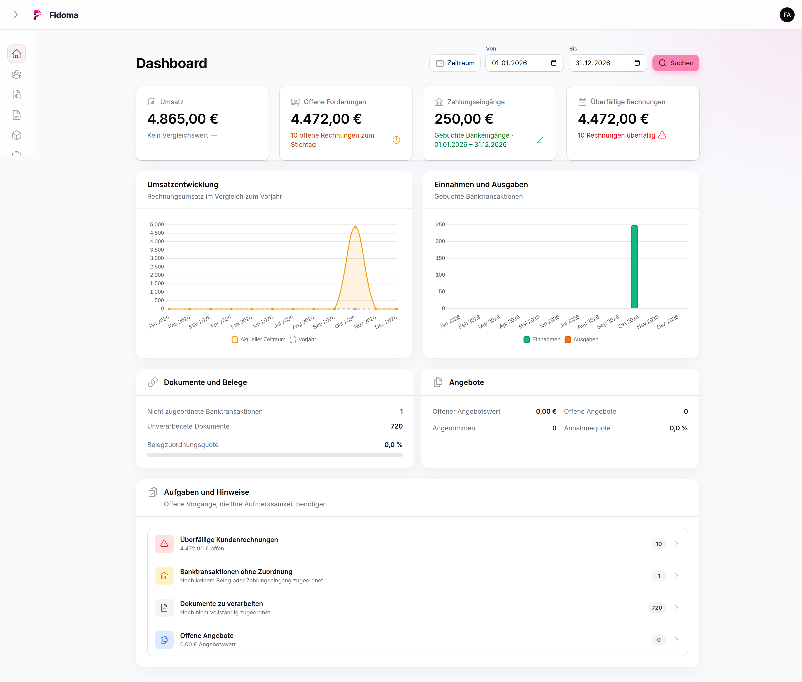
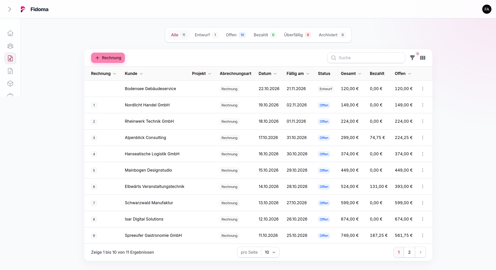
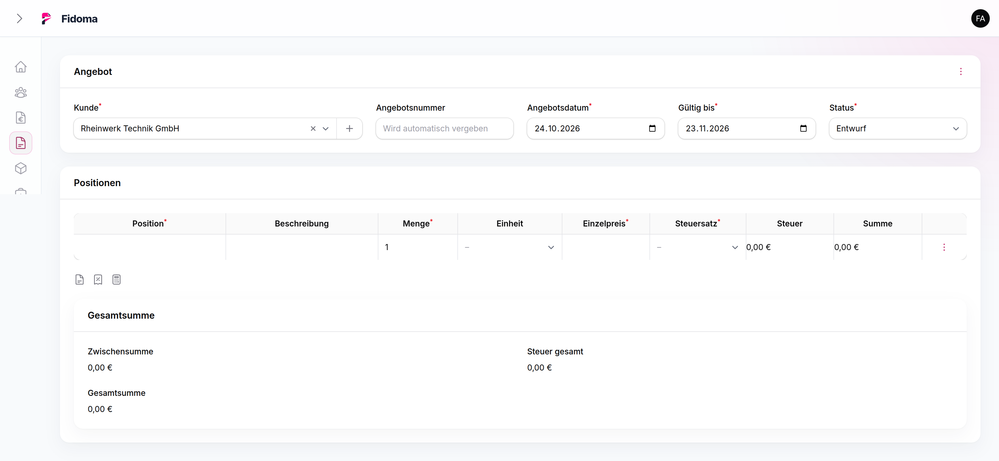

<div align="center">


# Fidoma

**A modular, self-hosted ERP & PMS for finance, operations and hospitality.**

[](https://github.com/Fidoma/Fidoma/releases/latest)
[](https://github.com/Fidoma/Fidoma/actions/workflows/ci.yml)
[](composer.json)
[](#license)

[Website](https://fidoma.de) · [Documentation](https://fidoma.github.io/Fidoma/) · [Releases](https://github.com/Fidoma/Fidoma/releases) · [Contributing](CONTRIBUTING.md)

</div>

Fidoma brings commercial and hospitality workflows into one modern web application. Its feature-first architecture keeps business areas isolated and extensible, while Laravel, Filament and Livewire provide a consistent administration experience at `/admin`.

> [!IMPORTANT]
> Fidoma is under active development. Review the [release notes](https://github.com/Fidoma/Fidoma/releases), back up the database and storage, and test upgrades before deploying them to production.



## ERP capabilities

| Area | Implemented capabilities |
|---|---|
| Customers & projects | Customer and contact data, project relations, archiving and customer analytics |
| Quotes & invoicing | Quotes, invoices, credit notes, cancellations, progress/final invoices, configurable PDF layouts, email delivery and XRechnung export |
| Payments & banking | Manual and partial payments, payment methods, CSV bank import, duplicate detection and transaction assignment |
| Products & master data | Products, families, units, tax rates and document number sequences |
| Contracts | Contract templates, custom fields, terms and customer/project relations |
| Documents | Paperless-ngx documents and assignment to bank transactions |
| Reporting | Invoice, payment, sales, tax and German VAT advance-return views with exports |
| Operations | Dashboard KPIs, email templates, users, optional 2FA and module visibility settings |

## PMS & hospitality capabilities

| Area | Implemented capabilities |
|---|---|
| Rooms & reservations | Room master data, reservation items and open/confirmed/cancelled states |
| Planning | Visual reservation schedule, availability context and conflict indicators |
| Billing | Reservation totals and conversion of reservations into invoices |
| Analytics | Occupancy, reservation volume/value, room statistics and customer analytics |
| Tourism reporting | Reservation-based tourism statistics, plausibility checks and CSV export |
| Local demand context | Trade-fair date import and display in reservation planning |

Fidoma's current PMS scope focuses on accommodation operations. It does **not** currently include a public booking engine, OTA/channel-manager connectivity or housekeeping management.

## Who Fidoma is for

- Small and medium-sized businesses that want self-hosted invoicing, payments and operational reporting.
- Professional services and trades that work with customers, projects, quotes and progress invoices.
- Hotels, guest houses and accommodation providers that need room planning, reservations, billing and tourism statistics.
- Teams that want to extend an ERP/PMS through clearly separated Laravel features rather than a monolithic module layer.

## Screenshots

| Invoicing | Reservations |
|---|---|
| [](docs/screenshots/invoices.png) | [](docs/screenshots/reservations.png) |

| Quotes | Reports |
|---|---|
| [](docs/screenshots/quotes_create.png) | [](docs/screenshots/reports.png) |

More interface examples are available in the [user guide](https://fidoma.github.io/Fidoma/user-guide/overview.html).

## Architecture

Business code lives in `app/Features/<Feature>` and is organized into the layers a feature actually needs: Filament resources and pages, Livewire components, actions, queries, services, models, policies, enums and local translations. This keeps ownership explicit and lets cross-cutting views—such as the dashboard—reuse domain logic without duplicating it.

The current stack is:

- PHP 8.3 or newer; development and CI use PHP 8.5
- Laravel 13, Filament 5 and Livewire 4
- MySQL 8.4
- Vite 8 and Tailwind CSS 4
- PHPUnit 12 and Laravel Pint
- DomPDF for PDFs and `horstoeko/invoicesuite` for XRechnung

See the [architecture guide](https://fidoma.github.io/Fidoma/developers/architecture.html) and [module guide](https://fidoma.github.io/Fidoma/developers/modules.html) for details.

## Integrations

- **Paperless-ngx** for document metadata and assignment workflows
- **ZVTAPI Gateway** for payment-terminal transactions (the terminal is not addressed directly)
- **SMTP** for quote and invoice delivery
- **Roundcube/IMAP** for embedded webmail
- **XRechnung** file generation

Bank transactions are currently imported by CSV; the open-source repository does not contain a FinTS client. See the [integration matrix](https://fidoma.github.io/Fidoma/integrations/overview.html) for prerequisites and boundaries.

## Installation

### Recommended: Docker release installation

Requirements: Docker Engine, Docker Compose v2 and a supported Linux host.

Download and extract the [latest release archive](https://github.com/Fidoma/Fidoma/releases/latest), then run:

```bash
chmod +x setup.sh
./setup.sh
```

The setup creates `.env.production`, generates credentials and an application key, starts the application, queue worker, scheduler and MySQL, runs migrations, and creates the first administrator. Read the generated `.fidoma-admin` file once, change the password after signing in, and then delete the file.

The complete production procedure, environment overrides and reverse-proxy notes are in the [installation guide](https://fidoma.github.io/Fidoma/getting-started/installation.html).

### Development with Laravel Sail

Requirements: Git, Docker Engine and Docker Compose v2. PHP, Composer, Node.js and MySQL do not need to be installed on the host.

```bash
git clone https://github.com/Fidoma/Fidoma.git
cd Fidoma
cp .env.example .env
docker run --rm \
  -u "$(id -u):$(id -g)" \
  -v "$PWD:/app" -w /app \
  laravelsail/php85-composer:latest composer install
vendor/bin/sail up -d --build
vendor/bin/sail artisan key:generate
vendor/bin/sail artisan migrate
vendor/bin/sail npm install
vendor/bin/sail npm run build
vendor/bin/sail artisan make:filament-user --panel=admin
```

Open the application at `http://localhost:8000` and the administration panel at `http://localhost:8000/admin`. Configuration for email, external services, modules and production hardening is documented in the [configuration guide](https://fidoma.github.io/Fidoma/getting-started/configuration.html).

## Contributing and security

Contributions are welcome. Please read [CONTRIBUTING.md](CONTRIBUTING.md) before opening a pull request. To report a vulnerability, follow [SECURITY.md](SECURITY.md) and do not disclose security issues publicly.

## Project status and changelog

Fidoma is actively developed. Released changes and the current unreleased work are documented in [CHANGELOG.md](CHANGELOG.md). The source of truth for distributable builds remains [GitHub Releases](https://github.com/Fidoma/Fidoma/releases).

## License

This repository currently does not include a license file. The `composer.json` metadata contains an MIT declaration, but no license terms have been published in the repository, so GitHub does not detect a license. Until the maintainers add an explicit license, do not assume permission beyond the rights granted by applicable law.
