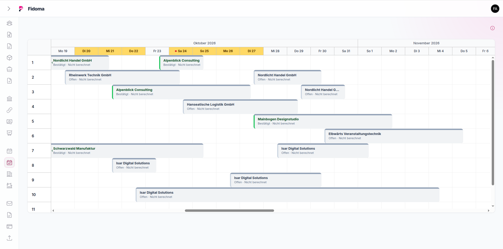
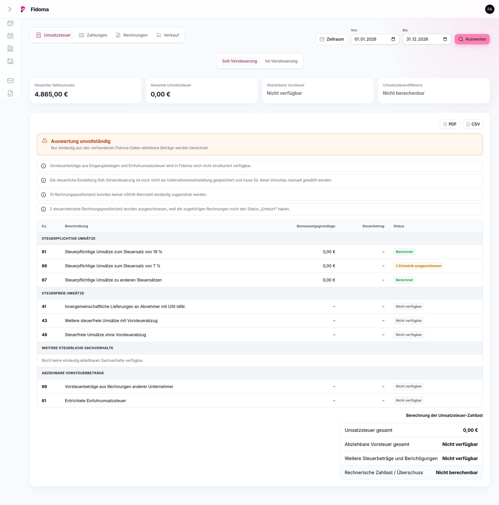

# Weitere Module

## Produkte und Stammdaten

Produkte verwenden Familien, Einheiten und Steuersätze. Nummernkreise formatieren fortlaufende Nummern für Angebote, Rechnungen und weitere Belegarten.

## Verträge

Vertragsvorlagen definieren eigene Felder. Verträge übernehmen diese Felder und können Kunden, Projekten, Orten sowie Laufzeiten zugeordnet werden.

## Reservierungen

Räume und Reservierungen werden in Listen und einem Zeitplan verwaltet. Reservierungen besitzen Positionen, Beträge und Status (offen, bestätigt, storniert) und können in Rechnungen überführt werden.

## Berichte

Die Berichtsseite bietet Rechnungs-, Zahlungs-, Umsatz-, Steuer- und UStVA-Auswertungen. Ein Export-Service erstellt herunterladbare Ergebnisse.

## Messen

Messetermine können als CSV importiert und nach Zeitraum abgefragt werden. Dieser Bereich dient der Terminübersicht und ist kein allgemeiner Kalender.

## E-Mail-Vorlagen und Webmail

Vorlagen unterstützen den Versand von Angeboten und Rechnungen. Webmail bindet eine konfigurierte Roundcube-Umgebung in Fidoma ein; es ist kein eigener Mailserver.
