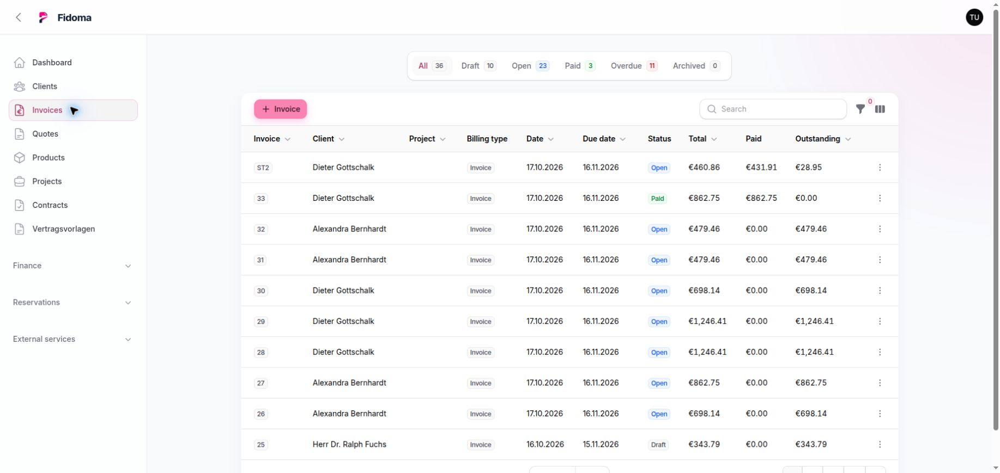

# Angebote & Rechnungen

## Angebote

Angebote verwenden Kunden, Produkte, Einheiten, Steuersätze, Rabatte und frei bearbeitbare Positionen. Die Statusfolge umfasst Entwurf, versendet, angenommen, abgelehnt und storniert. Ein angenommenes Angebot kann in eine Rechnung umgewandelt werden.

## Rechnungen

Fidoma unterstützt Rechnungen, Gutschriften und Stornorechnungen sowie Standard-, Abschlags- und Schlussabrechnung. Rechnungsstatus sind Entwurf, offen und bezahlt. Erst das Ausstellen macht aus einem Entwurf einen offenen Beleg.

Zur Verfügung stehen:

- PDF-Vorschau und PDF-Erzeugung über dieselbe Template-Verarbeitung
- anpassbare HTML-/CSS-Layouts ohne Ausführung von PHP oder Blade
- E-Mail-Versand über konfiguriertes SMTP
- XRechnung-Erzeugung
- Zahlungserfassung und Banktransaktionszuordnung
- Archivierung sowie Erzeugung eines Gegenbelegs für Gutschrift oder Storno

## Typischer Ablauf

1. Kunde, Nummernkreis und Positionen wählen.
2. Summen und Steuern prüfen.
3. Entwurf speichern und Vorschau kontrollieren.
4. Rechnung ausstellen.
5. PDF/XRechnung versenden oder herunterladen.
6. Zahlung manuell, per Bankzuordnung oder Terminal verbuchen.

